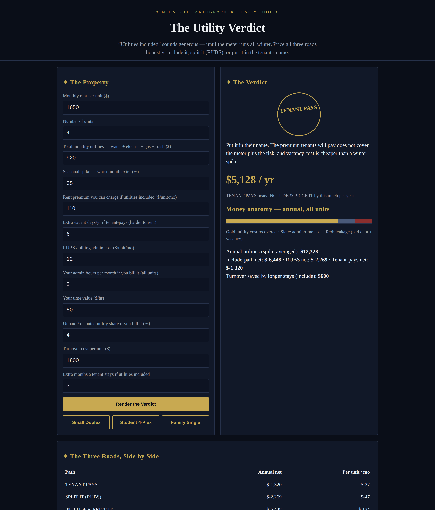

# The Utility Verdict

**Live:** https://thebullbrew.github.io/utility-verdict/
**Repo:** https://github.com/thebullbrew/utility-verdict

## What it does
Judges who should pay the utilities — landlord included, RUBS split, or tenant pays — for landlords and small multifamily investors. It prices the included premium against spike-averaged utility cost and turnover saved from longer stays, RUBS recovery against admin, your time and bad debt, and tenant-pays against the extra vacancy it can cause, then seals the winner with a break-even included premium and a premium sensitivity table.

## The method behind it
Include = premium × units × 12 − utilities (spike averaged at one-third weight) + turnover saved. RUBS = utilities pass through except the unpaid share, minus billing admin and your hours. Tenant-pays = no meter risk, minus daily rent × extra vacant days. The cheapest road on paper loses if it costs you the most hassle — the seal says so when the gap is under $600.

## How to run
Open `docs/index.html` in any browser, or visit the live link above. Works offline as a PWA. No backend, no accounts, data stays in localStorage.
